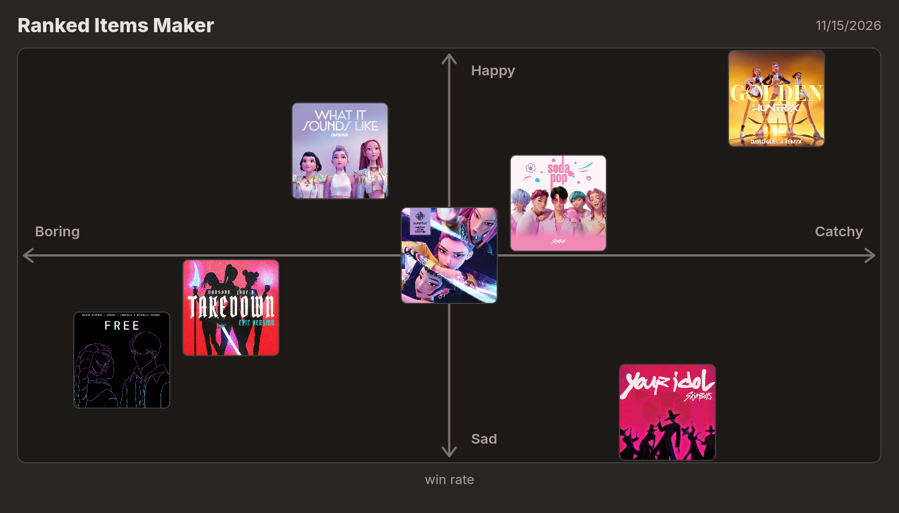

## Les tier lists

Bon, vous n'êtes sans doute pas étrangers au concept de Tier List, très populaires via [tiermaker.com](https://tiermaker.com/).

Sauf que le concept m'a toujours un peu embêté : okay on s'amuse à classer différents éléments les uns par rapport aux autres, et chacun à un classement différent donc c'est marrant de comparer.

Mais il manque quelque chose... Et j'ai récemment mis le doigt dessus : la subjectivité est trop aléatoire. On ne sait pas sur quel critères les éléments sont comparés, et les catégories sont trop restrictives, des axes continus seraient de biens meilleurs idées.

## Du versus

Du coup j'ai réglé ce problème (très personnel j'avoue) en créant une app qui permet de faire des classements en comparant des éléments 1 à 1. Comme ça, chaque élément a un score qui est bien plus représentatif de sa distance avec les autres éléments, et puis c'est plus amusant globalement, de voir ça comme des matchs.

Allez, un petit example pour la route. Vous connaissez Kpop Demon Hunters ? (vous devriez !) Voici le classement des chansons de ce film d'animation, selon moi en tout cas...

Si ça vous intéresse, j'ai rendu public [le site qui permet de créer ces classements](https://loic-lhf.github.io/RankedList/). Utilisez-le comme bon vous semble !

**_Enjoy, la bise. LL._**